<h1 align="center">Jhonatan Gonzaga</h1>

Estudante do 4º período de Engenharia de Software na UFAM, com interesse em Visão Computacional, Inteligência Artificial e Segmentação de Imagens.

Sobre mim

Sou estudante de Engenharia de Software na Universidade Federal do Amazonas. Tenho interesse em visão computacional e segmentação de imagens, e também desenvolvo automações com inteligência artificial.

No GitHub, organizo estudos e projetos acadêmicos em linguagens como TypeScript, Python, C, JavaScript e HTML. Quero construir uma base sólida para criar aplicações que trabalhem com imagens, dados e interfaces fáceis de acompanhar.

Tecnologias no meu GitHub

Projetos públicos

<table>
<tr>
<td width="50%">
<a href="https://github.com/jhonatan-gonzaga/Atendimento-com-IA-guiado-pelas-regras-da-empresa"><strong>Atendimento com IA guiado pelas regras da empresa</strong></a> 
MVP de atendimento automatizado criado com n8n e Gemini. O comportamento é guiado por regras de negócio versionadas em JSON: para adaptar a solução a outra empresa, edite <code>knowledge/empresa.json</code> e regenere o workflow. Inclui demonstração aplicada à Conecta Obras.  
<code>HTML</code> <code>n8n</code> <code>Gemini</code>
</td>
<td width="50%">
<a href="https://github.com/jhonatan-gonzaga/Coleciona-"><strong>Coleciona-</strong></a> 
Aplicação para organizar coleções e seus itens, com fotos e atributos tipados. A interface usa React + Vite, a API usa Node/Express e os dados ficam no MongoDB 8 configurado em replica set de três nós. O projeto inclui testes e experimentos de failover e carga, com evidências para avaliar requisitos não funcionais.  
<code>JavaScript</code>
</td>
</tr>
<tr>
<td width="50%">
<a href="https://github.com/jhonatan-gonzaga/conectaObras"><strong>conectaObras</strong></a> 
Aplicação de portfólio construída com Flask e PostgreSQL, organizada em camadas de models, repositories, services e web. Reúne apresentação de trabalhos, envio seguro de arquivos e avaliações.  
<code>Python</code> <code>Flask</code> <code>PostgreSQL</code>
</td>
<td width="50%">
<a href="https://github.com/jhonatan-gonzaga/Trabalho-Pr-tico-I-rvores-Balanceadas"><strong>Trabalho Prático I: Árvores Balanceadas</strong></a> 
Implementação e comparação de árvores AVL e Rubro-Negra em um sistema de Cadastro de Veículos. O trabalho inclui experimentos A–D, gráficos dos resultados e testes para observar o comportamento das estruturas.  
<code>Algoritmos</code>
</td>
</tr>
<tr>
<td width="50%">
<a href="https://github.com/jhonatan-gonzaga/Licit-AI"><strong>Licit-AI</strong></a> 
Ferramenta para triagem de oportunidades de compras públicas publicadas no PNCP. Importa dados com rastreabilidade e analisa a aderência das oportunidades usando a API da OpenAI. Desenvolvida com Next.js 16 e SQLite nativo. (Fork.)  
<code>Next.js</code> <code>SQLite</code> <code>OpenAI</code>
</td>
<td width="50%">
<a href="https://github.com/jhonatan-gonzaga/projeto-embarcados"><strong>projeto-embarcados</strong></a> 
Sistema de monitoramento que usa Heltec LoRa 32 V2, ESP32 e sensor DHT22 para enviar telemetria por LoRa a uma Raspberry Pi. Na Raspberry Pi, uma câmera OAK-D e YOLO11 com OpenVINO verificam se há uma criança sozinha; quando confirmada, o sistema envia um alerta pelo Telegram.  
<code>Python</code>
</td>
</tr>
</table>

Contato

Você pode acompanhar meus projetos e estudos pelo GitHub:

